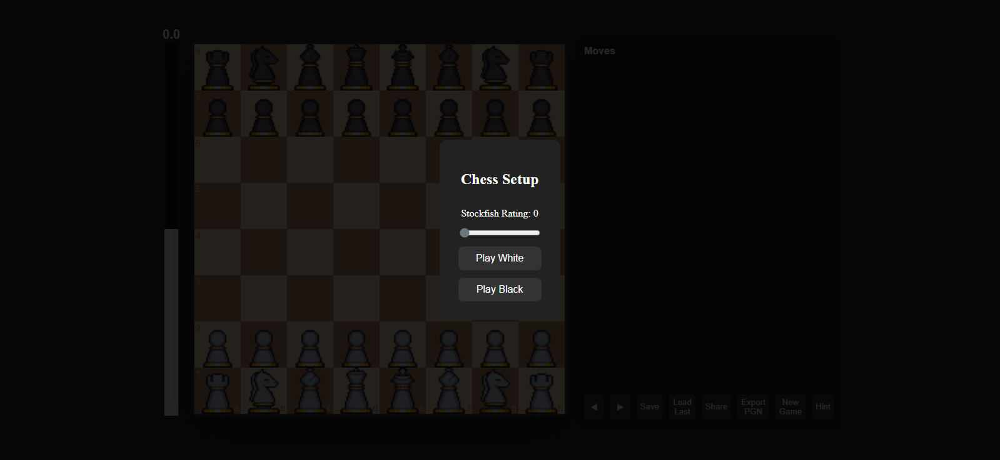
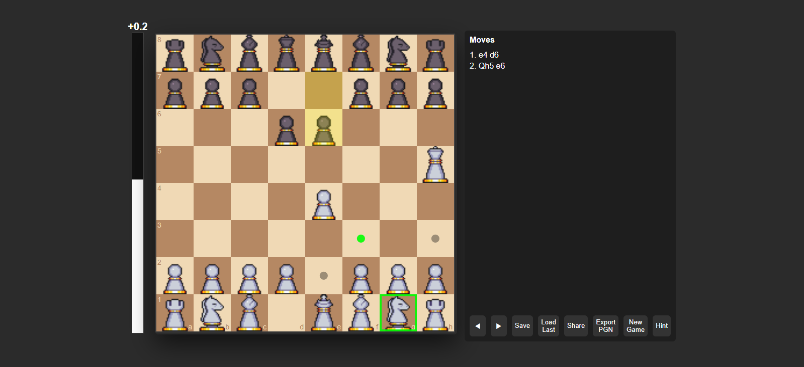
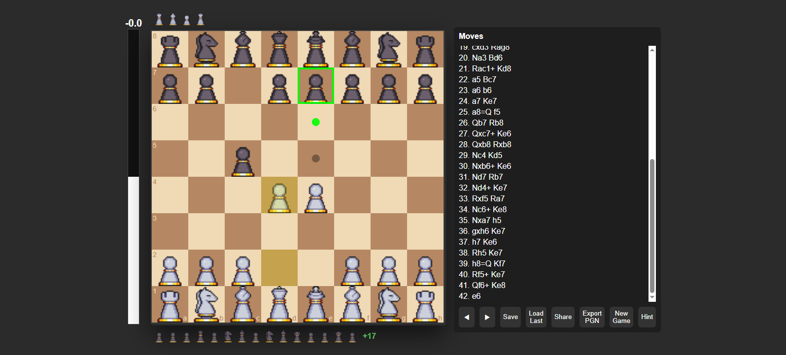

# Chess App

A browser-based chess application built with HTML, CSS, and JavaScript featuring a playable chess board and integrated Stockfish AI opponent.

## Features

- Play chess directly in the browser
- Integrated Stockfish chess engine
- Adjustable AI difficulty
- Move validation
- Legal move highlighting
- Game over detection
- Evaluation bar
- Move review mode
- Hint system
- PGN/game state saving
- Responsive UI

## Current State

This project currently features a playable frontend chess application with an in-progress FastAPI backend for authentication, persistence, and future multiplayer support.

The application uses:
- Custom UI built with vanilla HTML/CSS/JavaScript
- `chess.js` for move validation and game state
- `chessboard.js` for board rendering
- `Stockfish` running in a Web Worker for AI moves and evaluations

## Tech Stack

- HTML5
- CSS3
- JavaScript (Vanilla JS)
- Stockfish Engine
- chess.js
- chessboard.js

## Project Structure

```txt
frontend/
├── index.html
├── css/
│   └── style.css
├── js/
│   ├── script.js
│   └── stockfish.js
└── img/
```

## Screenshots

### Main Menu



### Gameplay



### Review Mode



## Running the Project

1. Clone the repository

```bash
git clone <your-repo-url>
```

2. Open the project folder

```bash
cd <project-name>
```

3. Run with a local server

Examples:

```bash
python -m http.server
```

or use the VS Code Live Server extension.

4. Open in browser

http://localhost:8000

## Future Roadmap

### Planned Features

- [ ] User accounts
- [ ] Game history database
- [ ] Mobile optimization
- [ ] Sound effects and themes
- [ ] Better UI polish and animations
- [ ] Opening explorer
- [ ] Move classification (Blunder/Mistake/Best/etc.)
- [ ] Timed games / chess clock
- [ ] Puzzle mode
- [ ] Opening training mode

## Goals

The long-term goal of this project is to become a full-featured chess platform with:
- Analysis tools
- Training features
- Playable AI
- Clean modern UI
- Persistent game storage

## License

MIT License